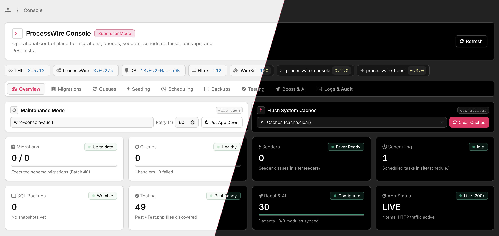

# ProcessWireConsole

Admin module (`Setup > Console`) for managing **`trk/processwire-console`** and **`trk/processwire-boost`** from the ProcessWire backend.



## Requirements

- PHP `>= 8.4`
- ProcessWire `>= 3.0.271`
- ProcessWire modules: `WireKit`
- Composer packages:
  - `trk/processwire-console` (migrations, queues, seeders, scheduling, backups, testing)
  - `trk/processwire-boost` (optional — AI guidelines, skills, MCP server)

## Installation

### 1. Via Composer & CLI

```bash
composer require trk/processwire-console
composer require --dev trk/processwire-boost
php vendor/bin/wire module:install ProcessWireConsole
```

### 2. Via ProcessWire Admin (Modules Directory / ZIP URL)

1. In the ProcessWire admin, go to **Modules > New**.
2. Install from the **Modules Directory** using class name `ProcessWireConsole`, or from **Add Module from URL** using:
   ```text
   https://github.com/trk/WireConsole/releases/latest/download/WireConsole.zip
   ```
3. Or download the release archive manually, extract it to `site/modules/WireConsole/`, go to **Modules > Refresh**, and click **Install** next to **Console** (`ProcessWireConsole`).

If `trk/processwire-console` is not installed yet, **Setup > Console** displays an onboarding screen with the required Composer commands.

## Quick Start

Open **Setup > Console** (`/processwire/setup/wire-console/`) in the ProcessWire admin, or access `ConsoleRuntime` from PHP:

```php
<?php

declare(strict_types=1);

namespace ProcessWire;

use Totoglu\WireConsole\ConsoleRuntime;

/** @var ProcessWireConsole $console */
$console = $this->wire()->modules->get('ProcessWireConsole');
$runtime = $console->runtime();

$versions = $runtime->getVersionMatrix();
if ($versions['console'] !== null) {
	$migrations = $runtime->getMigrationsStatus();
}

// Or resolve ConsoleRuntime directly:
$runtime = ConsoleRuntime::make($this->wire());
```

## Tabs

- **Overview (`wire-console`):** System/package versions, status cards for each subsystem, maintenance mode (`wire down` / `wire up`), and cache clearing (`cache:clear`, `cache:wire:clear`, `module:refresh`).
- **Migrations (`wire-console-migrations`):** Inspect `site/migrations/` files, install `wire_migrations`, run pending migrations, rollback batches, reset/refresh/fresh, or create new migration files (`make:migration`).
- **Queues (`wire-console-queues`):** Inspect `site/queue/` handlers, create queue tables, process batches (`queue:work`), dispatch jobs (`queue:push`), retry/delete failed jobs, purge pending jobs, or create queue classes (`make:queue`).
- **Seeding (`wire-console-seeding`):** Inspect `site/seeders/` classes, run `DatabaseSeeder` or individual seeders (`db:seed`), and create new seeders (`make:seeder`).
- **Scheduling (`wire-console-scheduling`):** Inspect `site/schedule/` tasks, cron expressions, and next run times; run due or specific tasks (`schedule:run`) and create task classes (`make:task`).
- **Backups (`wire-console-backup`):** Create, download, restore (`db:restore`), and purge (`backup:purge`) `.sql` backups under `site/assets/backups/database/`.
- **Testing (`wire-console-testing`):** Browse `*Test.php` files, run Pest suites with filtered arguments (`--filter`, `--group`, `--testsuite`, `--stop-on-failure`, `--bail`, `--compact`), and create test files (`make:test`).
- **Boost & AI (`wire-console-boost`):** Inspect `AGENTS.md`, `.agents/boost.json`, `.agents/map.json`, and `SKILL.md` files; run `boost:update` / `boost:install`, install remote skills (`boost:add-skill`), test read-only MCP tools, and scaffold modules (`make:module`).
- **Logs & Audit (`wire-console-logs`):** Browse ProcessWire log channels (`wire-console-audit`, `errors`, `exceptions`, etc.) with live search, entry limit selection, and channel clearing (`log:clear`, `log:clear-all`).

## Directory Structure

```text
site/modules/WireConsole/
├── ProcessWireConsole.module.php     # Process module (Setup > Console)
├── ProcessWireConsole.css            # Workspace styles
├── ProcessWireConsole.js             # Tab URL & breadcrumb sync
├── src/
│   ├── ConsoleRuntime.php            # Service layer (Totoglu\WireConsole\ConsoleRuntime)
│   └── Concerns/                     # Subsystem traits
├── components/
│   ├── ConsoleWorkspace.php          # Main HTMX workspace component
│   ├── ConsolePanelComponent.php     # Base class for tab panels
│   ├── Console*Panel.php             # Individual tab components
│   └── Concerns/
│       └── HandlesWorkspaceMutations.php
├── ui/
│   ├── ConsoleVersionStrip.php
│   └── ConsoleOnboardingCard.php
└── tests/
    └── Feature/
```

## Hooks

Hookable methods on `ProcessWireConsole`:

- `ProcessWireConsole::execute()`
- `ProcessWireConsole::executeNavJSON(array $options = [])`
- `ProcessWireConsole::executeDownloadBackup()`
- `ProcessWireConsole::breadcrumb(string $href, string $label = '')`

```php
<?php

declare(strict_types=1);

namespace ProcessWire;

$wire->addHookAfter('ProcessWireConsole::execute', function (HookEvent $event): void {
	$user = $event->wire()->user;
	if ($user->isSuperuser()) {
		$event->wire()->log->save('wire-console-audit', 'Console opened by ' . $user->name);
	}
});
```

## CLI Equivalents

```bash
php vendor/bin/wire migrate:status --json
php vendor/bin/wire migrate --json
php vendor/bin/wire migrate:rollback --json
php vendor/bin/wire queue:work default --max-jobs=5 --json
php vendor/bin/wire db:seed --class=DatabaseSeeder --json
php vendor/bin/wire schedule:run --json
php vendor/bin/wire db:backup --json
php vendor/bin/wire test
php vendor/bin/wire boost:update --discover
php vendor/bin/wire log:tail wire-console-audit
```

## Permissions & Security

| Permission | Access |
|---|---|
| `wire-console` | Access `Setup > Console` and the Overview tab |
| `wire-console-migrations` | View Migrations tab |
| `wire-console-queues` | View Queues tab |
| `wire-console-seeding` | View Seeding tab |
| `wire-console-scheduling` | View Scheduling tab |
| `wire-console-backup` | View Backups tab |
| `wire-console-testing` | View Testing tab |
| `wire-console-boost` | View Boost & AI tab |
| `wire-console-logs` | View Logs & Audit tab |

- Non-superuser roles with `wire-console-*` permissions get **read-only** access.
- Read-only file inspection (`queryInspectFile` / `inspectProjectFile`) enforces the permission of the tab that owns the category (`wire-console-migrations`, `wire-console-queues`, `wire-console-seeding`, `wire-console-scheduling`, `wire-console-testing`, `wire-console-boost`), and inspecting or downloading `.sql` backups requires **superuser** privileges plus `wire-console-backup`.
- Running migrations, queues, seeders, backups, restores, tests, cache flushes, or file generators requires a **superuser** account and confirmation input.
- All state-changing actions are logged to the `wire-console-audit` log channel (which is removed automatically on module uninstall).
