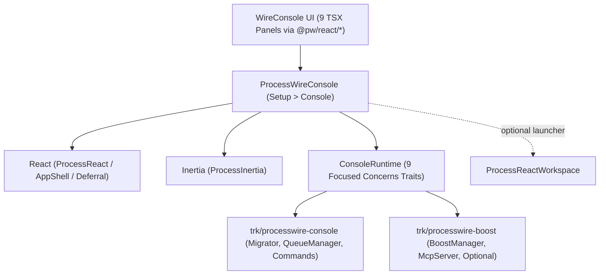

# ProcessWireConsole Architecture

`ProcessWireConsole` (`site/modules/WireConsole`) is the ProcessWire Admin control plane (`Setup > Console`, `{admin}/setup/wire-console/`) for operating **`trk/processwire-console`** and **`trk/processwire-boost`** over Inertia v3 + React 19 + Tailwind CSS v4.

---

## 1. Layering & Dependencies

`WireConsole` sits in the **React-Dependent Layer** and treats ProcessWire + `Inertia` + `React` + the Composer console packages as its only direct dependencies:

- **Required dependencies:** `PHP >= 8.4`, `ProcessWire >= 3.0.271`, `Inertia`, `React`.
- **Zero reverse coupling:** Neither `ProcessWireConsole.module.php` nor `src/` references upper-layer domain modules or peer React applications (`tests/Unit/LayeringTest.php` enforces the allowlist `['WireConsole', 'React', 'Inertia']` and `rw-` CSS/data prefix boundary).
- **Direct package delegation:** Schema migrations, queue workers, seeders, cron tasks, backups, Pest/Playwright runners, scaffolding, and Boost/MCP execution delegate to `Totoglu\Console\*` and Symfony Console `--json` commands rather than duplicating engine code.

---

## 2. Boot, Lazy Registration & Lifecycle

1. **Single-point class loading:** `ProcessWireConsole::__construct()` registers the `Totoglu\WireConsole` namespace (`__DIR__ . '/src/'`) strictly once through `WireClassLoader::addNamespace()`.
2. **Side-effect-free metadata:** `static getModuleInfo()` declares the 9 `wire-console*` permissions using literal `PERMISSION_*` constants matching `ConsoleRuntime::PERMISSION_*`, ensuring ProcessWire module discovery never autoloads `src/` prematurely.
3. **Pull-discovery deferral (`autoload => false`):** `ProcessWireConsole` declares `'autoload' => false` and `'reactCapabilities' => ['workspace', 'icons', 'commandSearch']` in `getModuleInfo()`. Frontend requests never instantiate `ProcessWireConsole`; when `React` pulls `'workspace'`, `'icons'`, or `'commandSearch'` capabilities (or when `Setup > Console` executes), `init()` registers admin vector icons and attaches deferred callbacks via `React::deferModuleRegistration($this, ...)` and `React::deferCommandSearchRegistration($this, ...)`:
   - `'console'` workspace (`Setup > Console`, required permission `wire-console`).
   - `'console-overview'` dashboard widget (`System Health & Operations`, lazily evaluated with per-section RBAC links only when an authorized user renders `ProcessReactWorkspace`).
   - `'wire-console'` command palette search provider (`/_react/command-search`, lazily searching accessible Console sections and discovered migrations, queues, seeders, scheduled tasks, and Boost skills).
4. **Full uninstall cleanup (`___uninstall()`):** Calls `React::forgetSharedWorkspace('console')`, `React::forgetSharedWidget('console-overview')`, `React::forgetDeferredRegistrations($this)`, and `commandSearch()->unregister('wire-console')` (when resolved), deletes `wire-console-audit` logs and `wire-console*` cache entries, removes the `wire-console*` permissions, and runs parent Process module page cleanup.

---

## 3. Domain Coordinator Decomposition (`ConsoleRuntime`)

`ProcessWireConsole::runtime()` returns a wired `Totoglu\WireConsole\ConsoleRuntime` instance composed from nine focused traits under `site/modules/WireConsole/src/Concerns/`:

| Trait | Responsibility |
|---|---|
| `HandlesWorkspaceActions` | CSRF + superuser + non-demo + confirmation-word + cooldown-rate-limited action dispatch (`34` guarded actions) and permission-checked `inspectProjectFile()` (`inspectFile`) |
| `InteractsWithSystemAndLogs` | Runtime version/composer overview telemetry, maintenance mode (`wire down` / `wire up`), cache clearing, redacted structured `audit()`, and ProcessWire log inspection/clearing |
| `InteractsWithMigrations` | `wire_migrations` inspection, pending migration status, `migrate`, `rollback`, `reset`, `refresh`, `fresh` (with optional `.sql` snapshot), and `make:migration` |
| `InteractsWithQueues` | `queue_jobs` & `failed_jobs` inspection/installation, prepared SQL reads (`escapeTable()`), synchronous `workQueueBatch`, job dispatch, retry/delete/clear, pending purge, and `make:queue` |
| `InteractsWithSeedingAndScheduling` | Verified discovery & execution of `*Seeder.php` (`db:seed`), Faker readiness, verified `*Task.php` cron expressions & next-run computation (`schedule:run`), `make:seeder`, `make:task` |
| `InteractsWithBackups` | Database backup directory enumeration, `.sql` creation (`db:backup`), restore (`db:restore`), retention purge (`backup:purge`), bounded SQL file preview, and download verification |
| `InteractsWithTesting` | `*Test.php` and `*.spec.ts` discovery, token-allowlisted `proc_open` runners for Pest (`wire test`) and Playwright (`wire test:e2e`, `--init`), `make:test` |
| `InteractsWithBoost` | `AGENTS.md`, `SKILL.md`, and `.agents/boost.json` management, `boost:update`, `make:module`, MCP guard status (`PW_MCP_ALLOW_EXECUTE`, `PW_MCP_ALLOW_RESTORE`), and read-only in-process `McpServer` execution (`28` `pw_*` tools) |
| `InteractsWithScaffolding` | Shared safe scaffolding execution via `Totoglu\Console\Commands\Make*Command` classes |

---

## 4. Security Architecture

Every route and backend operation enforces defense-in-depth checks:

- **Section-level RBAC visibility:** Non-superuser accounts with `wire-console` plus a subset of `wire-console-*` permissions get strictly read-only views scoped to permitted tabs (`buildWorkspacePayload()` falls back unauthorized tabs to `'overview'`, emits `null` for disallowed slices, and strips host root paths via `redactWorkspacePathsForNonSuperuser()`).
- **4-stage mutation gate:** Every `POST ./action/` dispatch enforces:
  1. Valid ProcessWire `$session->CSRF` token (`_token` or `X-CSRF-Token`).
  2. Authenticated ProcessWire **superuser** and `$config->demo` disabled (except allowlisted read-only `runMcpReadOnlyTool`).
  3. Action-specific confirmation token matching `confirm_<guardKey>`.
  4. Per-session cooldown enforcement (`checkRateLimit()`).
- **Filesystem & class-discovery containment:** `ConsoleRuntime::discoverVerifiedClasses()` and `inspectProjectFile()` enforce identifier regexes, `basename()`, `!is_link()`, `realpath()` project-root/directory containment, and `ReflectionClass` (`!$ref->isAbstract() && $ref->isSubclassOf(...)`) before loading or inspecting any file. SQL backup inspection and `./download-backup/` downloads require **superuser**, `wire-console-backup`, and `$config->demo` disabled.
- **Bounded request bodies & redacted audit logging:** JSON requests enforce `MAX_JSON_BODY_BYTES = 65536`, `MAX_JSON_DEPTH = 16`, and `MAX_JSON_ELEMENTS = 256`. Every action appends a structured record to `wire-console-audit` with secret/token/password keys redacted.
- **Process execution safety:** Pest and Playwright runs reject shell metacharacters, validate every flag against explicit allowlists (`sanitizeTestArgs()`, `sanitizeE2eArgs()`), pass argv arrays to `proc_open`, and apply execution timeouts.

---

## 5. Frontend Workspace & Asset Isolation

`ProcessWireConsole` renders the `WireConsole/Workspace` Inertia page inside `React`'s `AppShell`, organizing operations into nine focused panels under `resources/ts/panels/`:

`OverviewPanel`, `MigrationsPanel`, `QueuesPanel`, `SeedingPanel`, `SchedulingPanel`, `BackupPanel`, `TestingPanel`, `BoostPanel`, and `LogsPanel`.

- **`@pw/react/*` consumption:** `resources/ts/entries/ProcessWireConsole.tsx` builds via root `vite.module.ts` into `dist/ProcessWireConsole.js`, consuming shared React, Inertia, `AppShell`, `DynamicIcon`, `SchemaField`, `Sheet` (source inspector), `ConfirmDialog`, `useKeyboardShortcuts` (`r` refresh), and `useTranslations` from `window.ReactWorkspaceRuntime` with zero duplicated runtime chunks.
- **Delta stylesheet & vector icons:** `resources/css/entries/WireConsole.css` compiles only module-specific Tailwind v4 utility rules into `dist/WireConsole.css`, paired with `ReactIcons.js` (`getModuleScriptAssets()`) and `IconManager::registerAdminIcons()` (`init()`).
